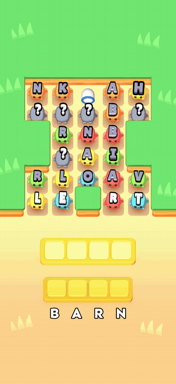

# Letter Pop: Fun Word Puzzle

Mobile word puzzle built in Unity. Players pick letter characters off a board to fill target words, without running out of space in the holding tray.

## My role

I was the sole programmer. All C# code in `Assets/_ProjectFiles` is mine. A game designer built the levels, and an artist handled art, VFX and UI layout.

## What I built

- **Gameplay:** board, letter units and navigation, word completion, letter dispensers and pipes, boosters, tutorial.
- **Level tools:** a custom level editor and pipe editor, so the designer could build levels without code.
- **Level data:** board generation and level loading.
- **Systems:** saves, audio, haptics, menus and a small MVVM layer for UI.
- **Release work:** Android and iOS builds, with AppsFlyer, AppMetrica, Facebook, Adjust and AppLovin MAX integrated across the release branches.

## Where to look

| Path | Contents |
| --- | --- |
| `Assets/_ProjectFiles/LevelEditor` | Level editor |
| `Assets/_ProjectFiles/LetterDispenser` | Dispensers and pipes |
| `Assets/_ProjectFiles/LetterUnit` | Letter characters and navigation |
| `Assets/_ProjectFiles/WordCompletion` | Word and tray logic |
| `Assets/_ProjectFiles/Analytics` | Analytics |

`main` holds the game itself. SDK integration is on `android-release` and `android-applovin`.

## Stack

Unity, C#, URP, DOTween, Git
